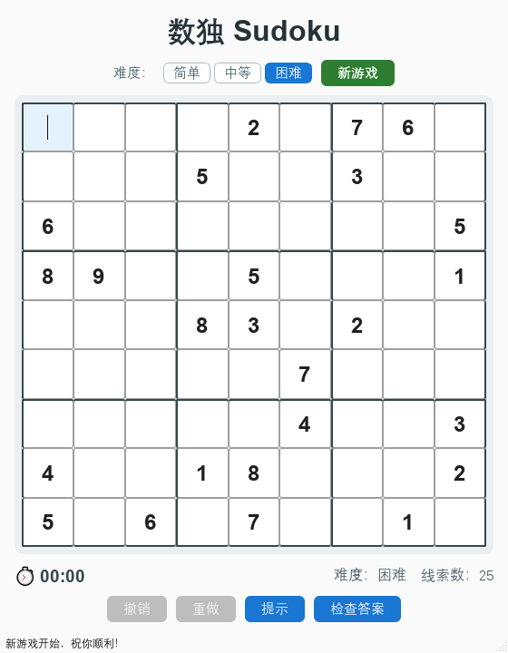

# 数独 Sudoku

一个现代 C++（C++20）+ **Qt 6 Widgets** 编写的数独游戏，界面与逻辑完全分层，包含完整游戏功能。




## 功能特性

- 🎯 **三档难度**：简单 / 中等 / 困难（线索数约 42 / 32 / 25，谜题保证唯一解），难度分段按钮点选即开局
- ❌ **错误检测与高亮**：输入与同行/列/3x3 宫冲突的数字即时红色高亮
- ⏱ **计时器**：实时显示用时，完成时展示总耗时
- 💡 **提示功能**：自动填入空格的正确数字（快捷键 `H`，可撤销）
- ↩️ **撤销 / 重做**：完整操作历史（`Ctrl+Z` / `Ctrl+Y`）
- ✅ **检查答案**：一键统计错误数字并高亮（快捷键 `C`）
- 🎉 **完成庆祝**：弹出完成对话框，显示难度与用时

## 环境要求

- **CMake ≥ 3.21**
- **Qt 6 Widgets + Qt6Test**（含 `uic` / `rcc` / `moc` 工具）
- 编译器：MSYS2 clang64 / MinGW / MSVC 均可（CMake 自动探测）

## 构建与运行

```bash
cmake -S . -B build -DCMAKE_PREFIX_PATH=<你的Qt6安装路径>
cmake --build build

# 运行单元测试
ctest --test-dir build

# 启动游戏
./build/sudoku.exe
```

> 界面结构（`src/mainwindow.ui`）、视觉样式（`styles.qss`）、游戏逻辑（`src/sudokuboard.cpp`）三者分离：
> 布局用 Qt Designer 编辑 `.ui`，样式改 `styles.qss` 即可，无需触碰逻辑代码。

## 项目结构

```
├── CMakeLists.txt              # 标准 CMake 构建（显式开启 AUTOMOC/AUTOUIC/AUTORCC）
├── LICENSE                     # MIT 许可证
├── resources.qrc               # Qt 资源文件（将 styles.qss 编译进可执行文件）
├── styles.qss                  # 全局样式表（QSS，与代码完全分离）
├── screenshots/sudoku.png      # 界面截图
├── src/
│   ├── mainwindow.ui           # 主窗口布局（Qt Designer 格式）
│   ├── sudokuboard.h/.cpp      # 数独核心逻辑（纯 C++，无 Qt 依赖）
│   │                           #   生成 / 求解 / 唯一解验证 / 冲突检测 / 撤销重做
│   ├── sudokucell.h/.cpp       # 棋盘单元格控件（QSS 属性选择器驱动样式）
│   ├── mainwindow.h/.cpp       # 主窗口逻辑（通过 ui_-> 访问 .ui 控件）
│   └── main.cpp                # 入口（加载 :/styles.qss 全局样式）
└── tests/
    └── test_sudokuboard.cpp    # 核心逻辑单元测试（Qt Test，8 个用例）
```

## 算法说明

- **生成**：随机化回溯填充完整解 → 按难度目标随机挖洞 → 每挖一洞用回溯计数验证唯一解，破坏唯一解则回填
- **求解**：MRV（最少候选优先）启发式回溯，毫秒级完成
- **检查**：行 / 列 / 3x3 宫三重冲突检测

## 许可证

本项目以 [MIT](LICENSE) 许可证发布。
